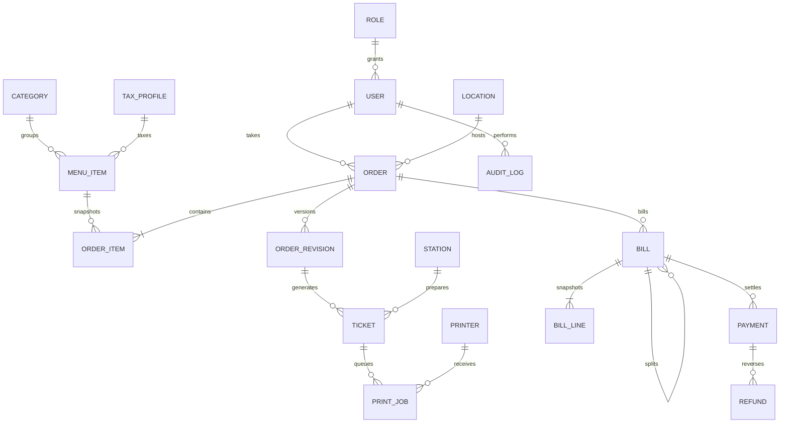

# The Wave POS — build design

Status: proposed implementation design; business inputs confirmed 2 November 2026.
Authority: ../../.. / PROMPT.md, with the confirmations below taking precedence.

## Confirmed inputs

- Windows 11 local server. Exact edition/build and virtualization support checked by installation preflight, not presumed.
- LAN printers not purchased. Implement raw ESC/POS adapter plus emulator; no hardware compatibility claim until specific models pass physical tests.
- INR. Food prices exclude 18% GST. Alcohol prices include 22% VAT. These are owner-provided configuration inputs, not independent tax advice.
- Cottages are locations with independent restaurant settlements, never room-charge accounts.
- All routine operations work without internet when server and LAN remain available.

## Approach and scope

Use the prompt's React/TypeScript/Vite/Tailwind frontend, NestJS modular monolith, Prisma/PostgreSQL database and Caddy proxy. Deploy with Docker Compose on compatible Windows 11 Docker Desktop/WSL2. One repository contains web, API and shared financial types. A separate worker process uses the same backend code and database for print delivery.

This is the recommended approach; technology alternatives are unnecessary because the supplied specification already chooses the stack. Microservices add operational complexity without a requirement; SQLite would depart from the requested PostgreSQL foundation. NodeDR is a workflow reference only: do not import its AGPL code or assets.

Backend modules: identity, catalog, locations, orders, preparation, finance, printing, reports, audit and settings. Public entry point is Caddy HTTPS only. PostgreSQL and API ports stay on the private container network. WebSocket messages invalidate authenticated clients' cached queries; REST responses remain authoritative. Commit first, broadcast afterwards. Reconnection refetches state.

## Financial rules

Use decimal arithmetic, never JavaScript floating point for money. Store prices/totals as NUMERIC, final amounts to two decimals. Round half-up per line/component; displayed line totals must sum to the bill. Persist the rounding delta where necessary. No automatic whole-rupee rounding.

Initial food profile: exclusive 18%, proposed local-service component split CGST 9% + SGST 9%. Alcohol profile: inclusive VAT 22%. Both are effective-dated editable profiles. The CGST/SGST split is an implementation default, not a separately confirmed user statement; admin can select an applicable alternative before live billing. No GST is added to alcohol carrying the VAT profile. Station routing never determines tax: non-alcoholic bar items can use food GST.

Examples, before discounts:

| Item entered price | Taxable base | Tax | Payable |
|---|---:|---:|---:|
| Food INR 100.00 | 100.00 | GST 18.00 | 118.00 |
| Alcohol INR 122.00 | 100.00 | VAT 22.00 | 122.00 |
| Mixed bill above | 200.00 | GST 18.00 + VAT 22.00 | 240.00 |

Discounts apply before tax: reduce exclusive food base; reduce inclusive alcohol selling price and extract VAT from the reduced price. An INR 12.20 alcohol discount makes the INR 122.00 item payable 109.80, base 90.00 and VAT 19.80. Allocation of fixed discounts uses eligible entered-price amounts, proportional largest remainder allocation in paise, with line-ID tie breaking. Mixed-basis discount preview explains actual payable reduction. Caps, eligibility, effective dates, stacking and approval are enforced server-side. Default no stacking.

Order lines snapshot menu price and tax version when submitted. Subsequent edits to menu/tax definitions never silently change submitted lines. Added lines take current configuration. Finalized bill snapshots are immutable. Price/tax corrections before payment require explicit manager action, audit and bill reissue. After payment, corrections use reversal/refund records.

Custom/equal splits allocate finalized base, discounts and each tax component in paise using largest remainders. Item/quantity splits retain underlying line references. Sum of every child component equals parent; parent is a non-payable grouping record once split. Splitting after a payment is rejected; reverse the payment with authorization first. No duplicate revenue counting.

Payments lock the payable bill inside a transaction, reject overpayment, use a unique idempotency key and store immutable entries. Cash tender/change is distinct from amount applied. UPI/card records are manual confirmations, not gateway verification. No card data stored. Refunds cannot exceed net paid amount, require manager approval/reason, and retain references. Complimentary settlement is manager-only and explicitly reported.

## Lifecycles and concurrency

- Order: OPEN, BILL_REQUESTED, BILLED, SETTLED, VOIDED. New amendments on unpaid BILLED orders explicitly invalidate that unpaid bill and return order to OPEN. No mutation once a payment exists without audited reversal. Void only unpaid orders with reason and authorized approval.
- Preparation ticket: immutable original/addition/change/cancellation/reprint records; station progress QUEUED, PREPARING, READY, SERVED. Ticket lines reference order revision. Notes-only changes on already sent items produce change tickets.
- Bill: ISSUED, PART_PAID, PAID, VOIDED, SPLIT_PARENT. Refund state derived from refund ledger, original bill retained.
- Print: PENDING, SENDING, SENT_UNCONFIRMED, FAILED, RETRY_REQUIRED. Socket success means SENT_UNCONFIRMED, never physical success.

All order changes use version checks. Transaction atomically writes revision, ticket, print job and audit entry. Idempotency record includes actor, operation, payload hash and response; reused key with different payload fails. Requests commit before success appears on phones. Concurrent invoices use database sequences/unique constraints; sequence gaps are retained, never reused. Each order may have only one active payable bill or split set.

Transfer retains order number, records old/new location and user, requires UI confirmation and version check. Existing tickets remain historical. Support multiple independent orders at a location and explicit waiter assignment; waiter access follows assignments, managers/cashiers have scoped global access.

## Printing

Administrator configures IP, port, role, station, paper width, encoding, protocol, enabled flag and optional fallback. Validate addresses against administrator-configured local printer networks; reject loopback/metadata/public targets. Port 9100 is a configurable candidate, not a compatibility guarantee. Printer role and preparation station are separate from tax profiles.

Worker claims jobs with database row locks and leases. A restart while SENDING marks RETRY_REQUIRED because bytes might already have printed. Only failures proven to occur before sending are eligible for bounded automatic retry/fallback. Ambiguous sends require operator inspection. Reprints create new jobs marked REPRINT with reason and actor; never overwrite originals. Ticket text includes order, location, waiter, revision, station, timestamp, notes and amendment type. Use INR text when the selected printer code page lacks the rupee glyph.

## Data relationships

Additional normalized tables: Permission/RolePermission/UserSession, TaxRuleVersion/TaxComponent, DiscountRule/DiscountApplication/Approval, MenuVariant/Modifier, TicketLine, PaymentMethod, Settings, IdempotencyRecord and EventOutbox. Foreign keys restrict deletion of referenced financial data; catalog/users/printers are disabled instead. Index order location/status, ticket station/status, print status/lease, payment bill/key, and report timestamps. Bill lines preserve tax components, quantities, item names, unit prices, discounts and allocation lineage independently of mutable catalog data.

## Interface and access

Mobile waiter: login, assigned tables/cottages, menu search/category filter, cart with notes, confirmed submission, active/history details, bill request. Cashier: floor overview, live orders, bill preview, discounts, transfers, splits, payment, receipt/history. Admin: users/permissions, menu/category/modifiers, tax/discount/payment rules, locations, printers, business settings, audit and backup actions. Kitchen/bar: own station queue. Reports: all dimensions in PROMPT section 21 with CSV and printable views.

Large touch targets, keyboard-accessible dialogs, explicit loading/error/unsent states. Cache only static app shell via PWA, not authenticated API responses. No offline financial submission; reconnect requires server revalidation. No externally loaded fonts or scripts.

Passwords hashed with Argon2id, opaque server-side sessions, HttpOnly/Secure/SameSite cookies, CSRF tokens on writes and origin checks on WebSockets. Validate request bodies, rate-limit login and enforce backend permissions for every operation. Short-lived bootstrap setup token provided only to local administrator, no shipped passwords. Logs redact credentials and session tokens. Database grants deny application deletion of finalized financial records. Backup/restore actions require administrator access; restore is an offline maintenance procedure, not an exposed unauthenticated endpoint.

## Windows and recovery

Installation preflight checks Windows build/edition, supported Docker/WSL2, virtualization, available storage, ports and network reachability. Compose health checks and restart policies; scheduled startup under the designated Windows account. Document Docker Desktop login/session limits and sleep prevention; power-cycle acceptance is mandatory. A supported always-on Linux VM remains the operational fallback if Desktop's session dependency is unacceptable.

Reserve server and printer LAN IPs. Installer takes actual hostname/IP; no fixed example addresses. Caddy internal CA with explicit trust instructions for Windows, Android and iOS; local DNS mapping required. Limit firewall to resort private subnet. Initial download/install requires internet; daily operation does not. Preserve database and Caddy CA volumes.

PowerShell invokes pg_dump custom-format backups, checks exit status and pg_restore listing, rotates only successful backups, and copies to a configured second destination. Scheduled daily backup default retention 30 successful daily backups. Restore test uses separate clean database, checks row counts and financial reconciliation, then executes a sample order. Backup checksums alone do not prove restore. No backup goes into GitHub.

## Delivery and acceptance

Seven phases follow PROMPT sections 26–27 and the linked Notion trackers. Each feature requires backend tests and evidence before Completed status. Unit tests cover monetary invariants; PostgreSQL integration tests cover atomicity/concurrency; Playwright tests cover waiter/cashier/admin/station flows; TCP emulator tests cover bytes/routing/failure. Restore, restart, internet outage and target Windows/phone/printer tests remain separate gates. Source-level or emulator success must never be described as production acceptance.

All 26 requirement groups remain planned until implementation. Windows/tax configuration questions are settled. Printer purchase is not a development blocker; it is a physical-acceptance prerequisite. Design approval is the next workflow gate, after which execute phases continuously with runnable commits and tracker updates.
